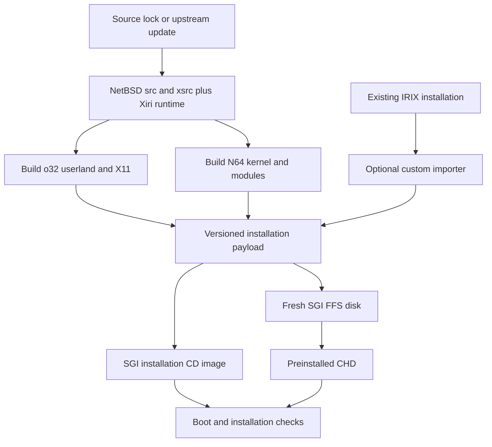

# XiriBSD distribution plan

XiriBSD should be a small distribution layer over the existing Xiri NetBSD
fork, using NetBSD's build and release machinery. This directory documents
how to turn [Xiri](https://github.com/salvogendut/xiri/blob/a3b283df395dd76b81154198d1d651d5d63ef96b/README.md) into an SGI-only distribution that
can incorporate upstream changes and produce an installation CD image and a
preinstalled emulator CHD through one command.

The recommended first target is an **Indy with a 64-bit big-endian kernel,
32-bit big-endian NetBSD userland, and the matching IRIX compatibility
module**. This preserves the architecture of the working desktop. Both
native build targets should use the same selected NetBSD source revision.
Other SGI models can follow through explicit hardware profiles.

| Requirement | Recommended implementation |
| --- | --- |
| A — SGI MIPS only | Build `MACHINE=sgimips`; qualify Indy first. Keep the complete upstream source tree and restrict build targets and published hardware claims. |
| B — Incorporate NetBSD upstream changes | Pin the source repositories with Git submodules. Keep `NetBSD-xiri`'s `xiri` integration branch and merge upstream `trunk` in an isolated candidate checkout. Advance the recorded submodule commits after qualification; track `xsrc` separately. |
| C — CD-ROM ISO and emulator CHD | Reuse NetBSD's SGI volume-header CD machinery. Build a fresh partitioned FFS disk from the same installation payload and compress it with `chdman createhd`. |
| D — One build script | Implement `./build.sh` here as the single public entry point for fetching, integration, compilation, staging, both images, verification and manifests. NetBSD's own `src/build.sh` remains the underlying OS builder. |

**Additional requirement recorded on 2026-11-14:** add custom scripting to
fetch the relevant IRIX materials from an existing IRIX installation. The
builder should invoke that importer when an IRIX source is supplied. This
is planned work; no new importer is implemented here.

Use submodules for NetBSD, Xiri and xsrc, with IRIS fetched when emulator
verification is requested. The future build script initializes them
automatically, so a normal clone followed by `./build.sh` remains sufficient.
The parent repository records the tested source commits; the source lock
supplies additional build settings, patch hashes and downloaded inputs.

Read [the distribution design](DESIGN.md) for the source strategy,
architecture, image formats and importer requirements. Read
[the implementation plan](IMPLEMENTATION.md) for the proposed command
interface, build stages, exact integration points and release checks.

Status: design and implementation requirements, researched on 2026-11-14.
The commands named for the future top-level script are its proposed
interface. This directory does not yet contain a working distribution
builder, installer, ISO or newly built CHD.
